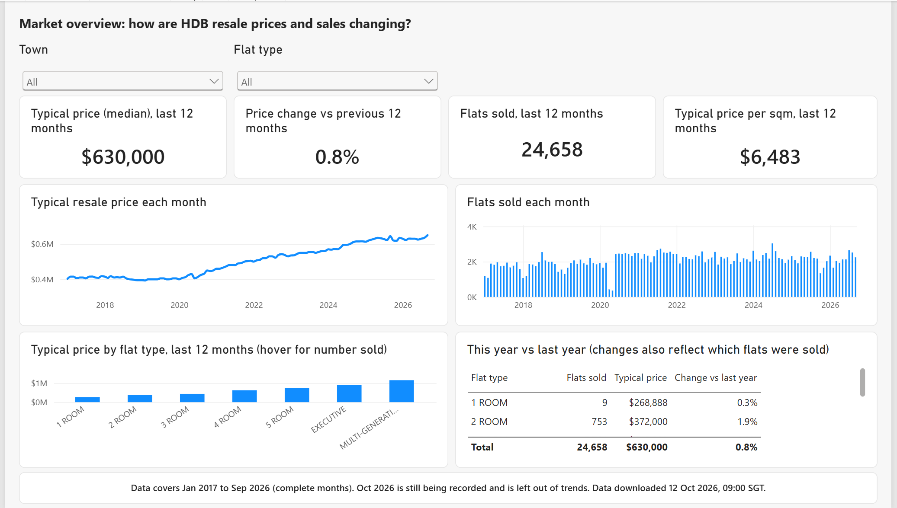
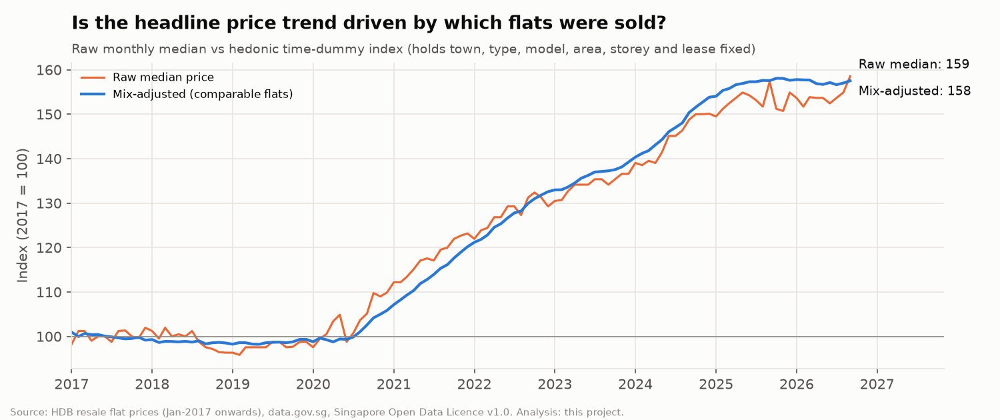
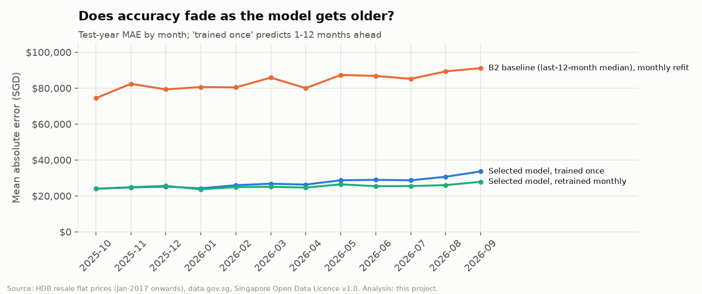
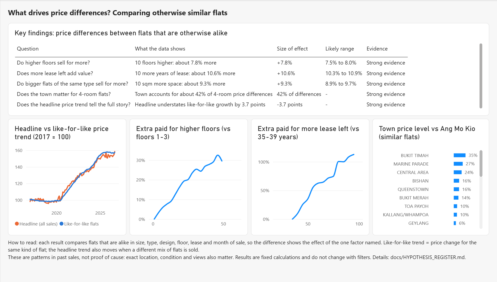
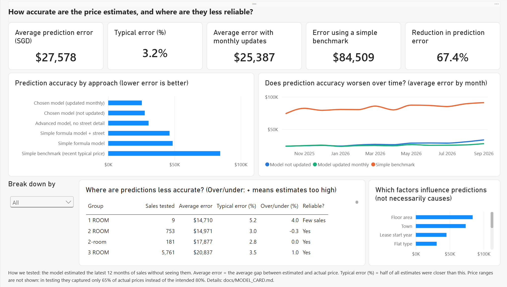

# HDB Resale Market Intelligence & Price Prediction

**Turning Singapore's public HDB resale records into reliable, explainable price intelligence**: market trends, fair like-for-like comparisons, evidence on what drives price differences, and an honestly tested price-estimation model, delivered through a reproducible Python/SQL pipeline and a plain-language Power BI report.

> Analytical study, not a valuation tool. Prices and estimates are indicative and must not be treated as achievable prices or official valuations.



## Contents
1. [Business problem](#1-business-problem) · 2. [Questions answered](#2-questions-answered) · 3. [Data source](#3-data-source) · 4. [Architecture](#4-architecture-and-data-flow) · 5. [Tools](#5-tools-and-technologies) · 6. [Setup and run](#6-setup-and-execution) · 7. [Data quality](#7-data-quality-and-cleaning) · 8. [Hypotheses and methods](#8-hypotheses-and-analytical-methods) · 9. [Model development](#9-model-development-and-validation) · 10. [Findings](#10-findings) · 11. [Power BI report](#11-power-bi-report) · 12. [Limitations](#12-limitations-and-responsible-interpretation) · 13. [Repository structure](#13-repository-structure) · 14. [Testing](#14-testing) · 15. [Reproducibility](#15-reproducibility) · 16. [Licence and notices](#16-licence-and-data-source-notices)

---

## 1. Business problem

Buyers, sellers and analysts compare resale flats using headline medians that mix very different flats and quietly shift as the mix of flats sold changes. The project asks:

> **How can Singapore housing market data be transformed into reliable, explainable price intelligence that helps users compare resale flats and understand the factors associated with price differences?**

## 2. Questions answered

| # | Question | Where answered |
|---|---|---|
| Q1 | How have resale prices and transaction volumes changed over time? | [Findings §10](#10-findings), report page 1 |
| Q2 | How do prices differ by town, flat type, floor area, storey, flat model and lease? | Report page 2, `outputs/tables/` |
| Q3 | Which characteristics are associated with price differences, and how strong is the evidence? | [Hypothesis register](docs/HYPOTHESIS_REGISTER.md), report page 3 |
| Q4 | How accurately can a model estimate prices, and where is it less reliable? | [Model card](docs/MODEL_CARD.md), report pages 4–5 |

## 3. Data source

| | |
|---|---|
| Dataset | *Resale flat prices based on registration date from Jan-2017 onwards* (`d_8b84c4ee58e3cfc0ece0d773c8ca6abc`) |
| Publisher | Housing & Development Board (HDB), via [data.gov.sg](https://data.gov.sg/datasets/d_8b84c4ee58e3cfc0ece0d773c8ca6abc/view) |
| Licence | [Singapore Open Data Licence v1.0](https://data.gov.sg/open-data-licence) |
| Snapshot used for published results | `20261012T010041Z` (retrieved 12 Oct 2026, 09:00 SGT), 242,454 rows, Jan 2017 to Sep 2026 (complete months) plus a partial Oct 2026 |

This is the **only** transaction source. Older HDB datasets and external data such as geocoding and amenities are deliberately excluded ([DEC-001](docs/DECISION_LOG.md)). Raw data is downloaded at runtime and not committed.

## 4. Architecture and data flow

```
data.gov.sg bulk-download API
   │  src/ingestion   full snapshot + manifest (timestamp, SHA-256, schema, row count)
   ▼
data/raw/<snapshot>/        immutable, git-ignored
   │  src/validation  schema contract + blocking gates (failed refresh never overwrites good outputs)
   │  src/transformation  strict parsing, quarantine of unusable rows, flags, derived fields
   ▼
data/processed/transactions_clean.parquet
   ├─ src/analytics   descriptive stats, hedonic regression, pre-registered hypotheses H1–H5
   ├─ src/modelling   baselines, Ridge, gradient boosting; chronological validation
   └─ sql/ (SQLite)   star schema + independent cross-check of pandas results
   ▼
outputs/ (tables, figures, model metrics)  →  data/curated/*.csv  →  powerbi/ (generated PBIP)
```

Full lineage: [docs/DATA_LINEAGE.md](docs/DATA_LINEAGE.md).

## 5. Tools and technologies

**Python 3.14** (pandas, NumPy, scikit-learn, statsmodels, SciPy, matplotlib, pyarrow, requests) · **SQL** (SQLite window functions) · **Power BI Desktop** (free), with the semantic model in TMDL, the report in PBIR and 37 DAX measures · **pytest** (121 tests) · **Git**.

## 6. Setup and execution

```bash
git clone https://github.com/kenkoo13/hdb-resale-market-intelligence.git
cd hdb-resale-market-intelligence
python -m venv .venv
.venv/Scripts/python -m pip install -r requirements-lock.txt      # Windows (macOS/Linux: .venv/bin/python)
.venv/Scripts/python -m src.pipeline                  # download + validate + clean   (~1 min)
.venv/Scripts/python -m src.analytics.run_analysis    # EDA, hypotheses, figures       (~3-5 min)
.venv/Scripts/python -m src.modelling.run_modelling   # models, evaluation             (~5 min)
.venv/Scripts/python -m src.reporting.build_bi_tables # SQL star schema + BI tables     (~20 s)
.venv/Scripts/python -m src.reporting.build_pbip --local-path   # Power BI project for your machine
.venv/Scripts/python -m pytest -q
```

Requires Python ≥ 3.12 (tested on 3.14.4). Then open `powerbi/HDB Resale Market.pbip` in Power BI Desktop and click **Refresh**. Details: [docs/REPRODUCIBILITY.md](docs/REPRODUCIBILITY.md), [docs/BI_BUILD_GUIDE.md](docs/BI_BUILD_GUIDE.md).

## 7. Data quality and cleaning

| Measure | Rows |
|---|---:|
| Source rows | 242,454 |
| Quarantined (with reasons, original text kept) | 147 |
| Clean | 242,307 |
| Partial month (Oct 2026, excluded from trends and models) | 750 |
| **Analysis-ready** | **241,557** |

- All 11 fields parsed; no blanks; 26 towns; no months missing between Jan 2017 and Oct 2026.
- **Duplicate investigation:** 2017 had 10× the duplicate rate of later years, and 294 of its 344 duplicate rows were priced at exactly SGD 468,000 or 470,000. No later year has duplicates at those prices. The 147 extra copies were quarantined as a suspected publication artefact; all other duplicates were kept as plausible twin sales ([DEC-013](docs/DECISION_LOG.md)).
- **Remaining lease** comes in three text formats, all parsed. It agrees with the lease start year to within the expected 0–1 year; the single inconsistent row is flagged, not altered.
- Every rule, count and decision: [docs/DATA_QUALITY.md](docs/DATA_QUALITY.md).

## 8. Hypotheses and analytical methods

- Five hypotheses, with their methods, a **2% practical-significance threshold** and the decision rules, were [committed to Git before any test ran](docs/HYPOTHESIS_REGISTER.md).
- **Method:** hedonic regression on log price, comparing flats sold in the same month, town, flat type and model while holding area, storey and lease fixed. Standard errors are clustered by building, and p-values Holm-corrected.
- **Robustness:** every result was re-checked on the full period, excluding duplicates, and with banded variables.
- **Town differences:** tested with a Kruskal–Wallis test and an ε² effect size.
- **Mix-adjusted price trend:** a hedonic time-dummy index.
- Every result is an **association**, not a cause.

## 9. Model development and validation

- **Use case:** estimate the typical registered price of comparable flats from attributes known before the sale ([model card](docs/MODEL_CARD.md)). The design was committed before training.
- **Chronological split:**
  - train: Jan 2017 – Sep 2024 (190,655 sales);
  - validation: Oct 2024 – Sep 2025 (26,244);
  - test: Oct 2025 – Sep 2026 (24,658), evaluated **once**.
- **Candidates:** baselines; Ridge regression with splines; HistGradientBoosting, each with and without street target encoding. 20 configurations were selected on validation only.
- **Leakage controls:** forbidden-feature guard; all preprocessing fitted inside the training pipeline; tests prove that validation prices cannot leak into encodings.
- **Evaluation:** static (trained once) and monthly refit; errors analysed by segment and by months since training; permutation importance.

## 10. Findings

All figures are from the 12 Oct 2026 snapshot. They are **associations in observational data**.

**Market (Q1, Q2)**
- Volumes: about 20,000–29,000 resales a year, with lows of 424 and 363 in Apr–May 2020.
- Typical (median) price in the last 12 months: **SGD 630,000**, ranging from SGD 440,000 for 3-ROOM to SGD 900,000 for EXECUTIVE (latest 24 months).
- Median 4-ROOM prices range from **SGD 537,500 (Jurong West) to SGD 1.2m (Central Area)**.

**Price drivers (Q3).** All are pre-registered, cleared the 2% threshold, and are robust:

| Factor (otherwise similar flats) | Price difference | 95% CI |
|---|---:|---|
| 10 floors higher | **+7.8%** | 7.5% to 8.0% |
| 10 more years of remaining lease | **+10.6%** (steepest below about 60 years left) | 10.3% to 10.9% |
| 10 sqm more floor area, same flat type | **+9.3%** | 8.9% to 9.7% |
| Town (4-ROOM) | Large effect, ε² = **0.42**; town effects span about 61 points after controls | — |

**Headline vs like-for-like.**
- Since 2017 the raw median rose **+53.7%**, but prices of comparable flats rose **+57.4%**.
- So the headline figure **understates** growth by **3.7 points**.
- This is consistent with the flats being sold getting older. That explanation is an interpretation, not a separate test.



**Price estimation (Q4).** Results on the held-out test year:

| Approach | Average error (SGD) | Typical error |
|---|---:|---:|
| Simple benchmark: town × flat-type median, past 12 months | 84,509 | 8.8% |
| Ridge regression + street | 46,280 | 5.5% |
| **Chosen model, gradient boosting + street, trained once** | **27,578** | **3.2%** |
| Chosen model, retrained monthly | 25,387 | 3.0% |

- The chosen model removes about two-thirds of the benchmark's error.
- Without retraining, error rises about 40% over 12 months. **Retrain monthly.**
- **Less reliable for:**
  - rare flat types and models (1 ROOM, MULTI-GENERATION, Terrace);
  - mature central towns (Marine Parade 5.5%);
  - streets with no past sales;
  - the price extremes: cheap flats are over-estimated, expensive ones under-estimated.
- 80% prediction intervals covered only **65%** of test prices, so they are **not published**.



## 11. Power BI report

A five-page report for **Power BI Desktop (free)**, written in plain business language: [glossary and wording audit](docs/DASHBOARD_GLOSSARY.md).

| Page | Business question |
|---|---|
| 1 Market overview | How are HDB resale prices and sales changing? |
| 2 Compare towns & flats | What do similar flats sell for? |
| 3 What drives prices | What drives price differences between otherwise similar flats? |
| 4 Estimate accuracy | How accurate are the estimates, and where are they less reliable? |
| 5 Estimated prices | What might a typical flat cost? (pre-calculated; filters do not re-run the model) |

The report is generated as a Power BI Project from code (`src/reporting/build_pbip.py`). It was verified in Power BI Desktop 2.158:
- it opens and refreshes;
- **13/13 DAX values equal the Python results**, all 37 measures evaluate, and 17/17 row counts match;
- five rounds of visual review were completed.

No `.pbix` is committed, and none is needed; save one from Desktop if required. Guide: [docs/BI_BUILD_GUIDE.md](docs/BI_BUILD_GUIDE.md).

| | |
|---|---|
|  |  |

## 12. Limitations and responsible interpretation

- **Observational data:** the results are associations. Exact location, condition, renovation and views are not in the data.
- **Registration month,** not agreement date. Floor area includes recesses and roof terraces. Storey is a three-floor band.
- **One test year** (a flat market). Accuracy in a fast-moving market will be lower unless the model is retrained frequently.
- **Rare segments** (fewer than 30 sales) are labelled less reliable throughout. No uncertainty intervals are published.
- **The 2017 duplicate rule** rests on strong internal evidence but has not been confirmed by HDB.
- **Not** a valuation, loan basis or negotiation tool. **Not** affiliated with or endorsed by HDB or the Singapore Government.

## 13. Repository structure

```
├── src/              ingestion · validation · transformation · analytics · modelling · reporting
├── sql/              SQLite star schema and cross-check aggregates
├── tests/            121 tests (synthetic fixtures only) + docs-consistency checks
├── docs/             plan, decision log (DEC-001..031), data dictionary, lineage, data quality,
│                     hypothesis register, metric dictionary, model card, BI guide, glossary,
│                     testing, reproducibility, handover, screenshots
├── outputs/          data-quality report, analysis tables, model metrics, figures (committed)
├── data/curated/     Power BI import tables (small ones committed; the fact table is regenerated)
├── powerbi/          generated Power BI Project (TMDL + PBIR) and validation scripts
├── config/           example configuration (defaults need none)
└── requirements*.txt direct pins + full lock file
```

## 14. Testing

```bash
.venv/Scripts/python -m pytest -q        # 121 passed (2026-10-12)
```

The tests cover:
- the schema contract, parsers, quarantine and duplicate rules, and refresh-failure safety (previous outputs stay byte-identical);
- leakage guards, the chronological split, metrics, and recovery of known synthetic effects;
- SQL-vs-pandas parity, every Power BI visual field existing in the model, and the documented figures matching the outputs.

Mutation checks confirmed the tests fail on injected defects. Details: [docs/TESTING.md](docs/TESTING.md).

## 15. Reproducibility

A fresh clone with the lock-file environment, run on the same raw snapshot, reproduced **every committed output exactly** (only wall-clock timings differ). A live re-download passed all gates. Python ≥ 3.12; random seed 42. See [docs/REPRODUCIBILITY.md](docs/REPRODUCIBILITY.md).

## 16. Licence and data-source notices

- **Code:** MIT ([LICENSE](LICENSE)).
- **Data and derived data:** Singapore Open Data Licence v1.0 ([DATA_LICENSE.md](DATA_LICENSE.md)).
- *Contains information from "Resale flat prices based on registration date from Jan-2017 onwards" accessed on 12 October 2026 from data.gov.sg, which is made available under the terms of the [Singapore Open Data Licence version 1.0](https://data.gov.sg/open-data-licence).*
- Independent project; not endorsed by HDB, data.gov.sg or the Government of Singapore.
