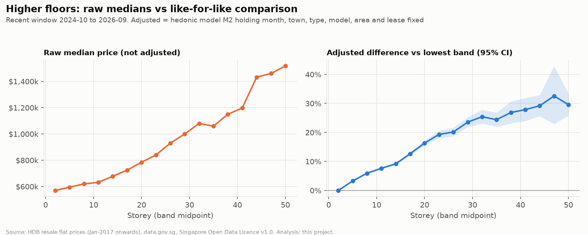
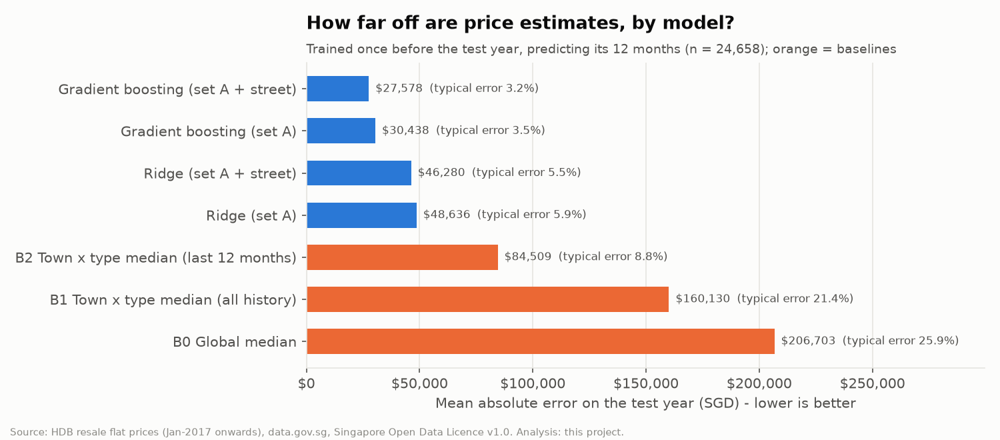

# HDB Resale Market Intelligence & Price Prediction

> **Project status: in progress (Phases 0–4 of 6 complete: source verified, data-quality pipeline, exploratory analysis, pre-registered hypothesis tests, price model, Power BI report).** End-to-end verification and the final portfolio write-up (Phases 5–6) are pending.

An end-to-end data analytics capstone that turns Singapore HDB resale transaction records into explainable price intelligence. It covers market trends, fair comparisons between flats, the evidence on which characteristics are associated with price differences, and an honestly evaluated price-estimation model, all delivered through a reproducible Python/SQL pipeline and a Power BI report.

**Data source:** "Resale flat prices based on registration date from Jan-2017 onwards", Housing & Development Board, via [data.gov.sg](https://data.gov.sg/datasets/d_8b84c4ee58e3cfc0ece0d773c8ca6abc/view), under the [Singapore Open Data Licence v1.0](https://data.gov.sg/open-data-licence). This is an independent project, not endorsed by HDB or the Singapore Government. See [DATA_LICENSE.md](DATA_LICENSE.md).

See [docs/PROJECT_PLAN.md](docs/PROJECT_PLAN.md) for scope and plan, and [docs/DECISION_LOG.md](docs/DECISION_LOG.md) for design decisions.

## Findings so far (Phase 2, snapshot of 12 Oct 2026)

All findings describe **associations in observational data**, not causes. Full evidence, methods and caveats are in [docs/HYPOTHESIS_REGISTER.md](docs/HYPOTHESIS_REGISTER.md). Hypotheses, methods and a 2% practical-significance threshold were [committed before testing](docs/HYPOTHESIS_REGISTER.md#0-pre-registration-statement).

| Question | Finding | Evidence |
|---|---|---|
| How have prices moved? | The median resale price rose from SGD 410,000 (2017) to SGD 630,000 (Oct 2025 – Sep 2026), **+53.7%**. | 241,557 analysis-ready transactions |
| Is that the true change for comparable flats? | No. Holding town, type, model, area, storey and lease fixed, prices rose **+57.4%**. The raw median *understates* growth by 3.7 points, which is consistent with the flats being sold getting older. That explanation is an interpretation, not a separate test. | Hedonic time-dummy index; the CIs of the two estimates do not overlap |
| Higher floors? | **+7.8%** per 10 floors for otherwise comparable flats (95% CI 7.5–8.0%). Raw medians exaggerate this because tall blocks cluster in pricier towns. | Supported, robust across 4 specifications |
| Remaining lease? | **+10.6%** per 10 extra years (CI 10.3–10.9%), steepest below about 60 years remaining. The figure mixes lease length with building age and condition. | Supported, robust |
| Floor area within a flat type? | **+9.3%** per extra 10 sqm (CI 8.9–9.7%) | Supported, robust |
| Does town matter for like-for-like flats? | Strongly. Median 4-ROOM prices range from SGD 537,500 (Jurong West) to SGD 1.2m (Central Area). After controls, town effects still span about 61 percentage points. | Kruskal–Wallis ε² = 0.42 (large) |

More figures are in [outputs/figures](outputs/figures). The data-quality results are in [docs/DATA_QUALITY.md](docs/DATA_QUALITY.md).

## Price estimation model (Phase 3)

The model estimates the **typical registered price of comparable flats**. It is not a valuation. The design, including the chronological split, candidate models, metrics and selection rule, was [committed before training](docs/MODEL_CARD.md). It was evaluated **once** on a held-out final year (Oct 2025 – Sep 2026, 24,658 sales) that played no part in any modelling choice.

| Model | Test MAE (SGD) | Typical % error |
|---|---:|---:|
| Baseline: town × flat-type median over the past 12 months | 84,509 | 8.8% |
| Ridge regression (+ street) | 46,280 | 5.5% |
| **Gradient boosting (+ street), trained once** | **27,578** | **3.2%** |
| Gradient boosting (+ street), retrained monthly | 25,387 | 3.0% |

- Accuracy fades when the model isn't retrained: MAE is about 40% higher 12 months after training. Retraining monthly keeps the typical error near 3%.
- Estimates are least reliable for rare flat types and models (1 ROOM, MULTI-GENERATION, Terrace), for mature central towns (Marine Parade at 5.5%), for streets with no past sales, and at the price extremes. The model over-estimates the cheapest flats and under-estimates the dearest.
- **80% prediction intervals failed their coverage check** (65% actual coverage), so they are deliberately **not** published.

See the [model card](docs/MODEL_CARD.md) for full results, limitations and prohibited uses.

## Power BI report (Phase 4)

A five-page report for **Power BI Desktop (free)**, written in plain business language for managers. It is generated as a Power BI Project from code (`src/reporting/build_pbip.py`). It was verified in Power BI Desktop: the project opens and refreshes, 13/13 DAX values match the Python results, and all 37 measures evaluate. Setup and validation are in [docs/BI_BUILD_GUIDE.md](docs/BI_BUILD_GUIDE.md), and every term is defined in [docs/DASHBOARD_GLOSSARY.md](docs/DASHBOARD_GLOSSARY.md).

| Page | Business question |
|---|---|
| 1 Market overview | How are HDB resale prices and sales changing? |
| 2 Compare towns & flats | What do similar flats sell for? |
| 3 What drives prices | Which features are linked to higher prices, comparing otherwise similar flats? |
| 4 Estimate accuracy | How accurate are the price estimates, and where are they less reliable? |
| 5 Estimated prices | What might a typical flat cost? (pre-calculated, for guidance only) |

Screenshots are of the real report (snapshot of 12 Oct 2026). To open it yourself, set the `CuratedFolder` parameter to your `data/curated/` folder (see the BI guide, §2).
